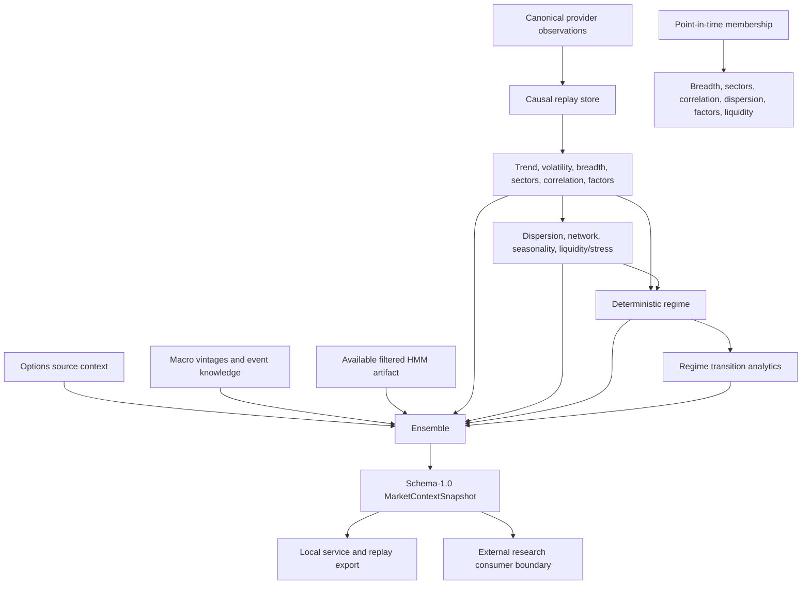

# MCE 1.0 system architecture

MCE-1 through MCE-19 established canonical observations, XNYS time rules, causal replay, trend, volatility, breadth, sectors/rotation, correlation, dispersion, liquidity/stress, deterministic regimes, transition analytics, statistical datasets and Gaussian HMM research, dynamic factors, market networks, intraday seasonality, options context, macro/event context, and explainable ensemble synthesis. MCE-20 connects these existing engines through `MarketContextPipeline`; it introduces no new quantitative model family.

The validated DAG is in `mce.orchestration.dependencies`. Stage registration order does not change the fixed execution order. The pipeline computes each upstream family once, passes same-clock typed results to dependent engines, and projects them in a fixed order. A request-scoped membership cache shares immutable `members(T)` answers across engines and is discarded after each snapshot. There is no global quantitative cache or mutable model state.

The base snapshot requires a configured broad-market universe, enabled trend and volatility engines, and at least one causally available completed regular-session bar from the configured source. Short history may still withhold scores and lower quality. Breadth, sectors, correlation, dispersion, factors, network, seasonality, liquidity/stress, regimes, HMM, options, macro, and ensemble can be withheld when inputs are unavailable. Programming and contract errors propagate from the pipeline; the HTTP boundary maps them to safe errors. The deterministic regime, filtered HMM, and ensemble headline remain separate.

`PipelineResult` contains the public snapshot, `SnapshotLineage`, a deterministic fingerprint of both, and separate `PipelineDiagnostics`. Lineage hashes only market observations available by the requested clock, point-in-time memberships, and supplied context. Runtime durations and request metadata never enter the snapshot fingerprint. Each calculation starts from a fresh snapshot, so an absent optional family cannot inherit old `options.*`, `macro.*`, `network.*`, `seasonality.*`, or `ensemble.*` fields.

The service accepts a preconfigured canonical observation batch. Vendor adapters, model training, and external source transport remain outside the feature engines. A downstream system such as AME may read the stable snapshot/API contract; decisions, positions, risk limits, and execution remain the consumer's responsibility.
